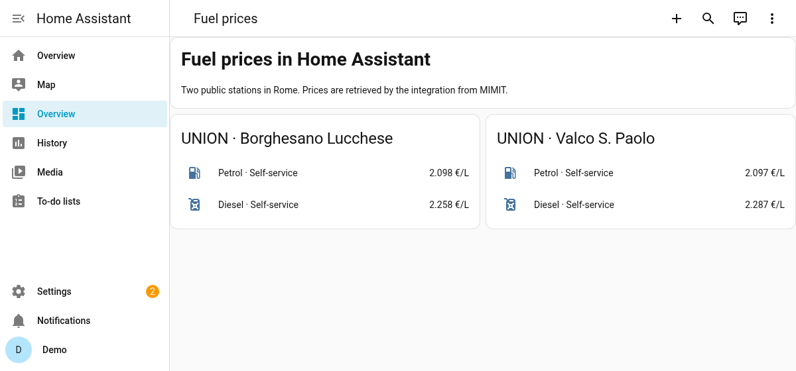
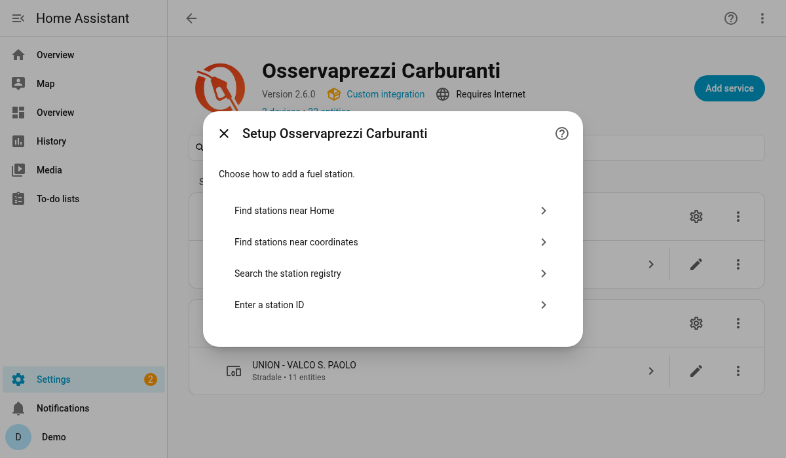
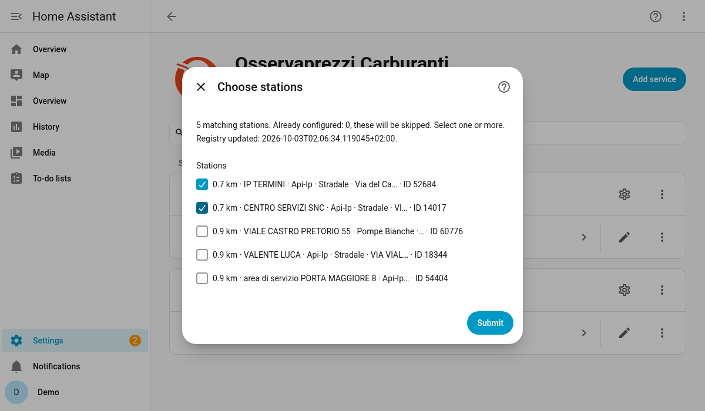

# Osservaprezzi Carburanti per Home Assistant

[🇬🇧 Read in English](./README.md)

Integrazione custom per Home Assistant che monitora prezzi, orari e servizi dei distributori italiani dalle fonti ufficiali [Osservaprezzi del MIMIT](https://carburanti.mise.gov.it/).

## Anteprima

Prezzi di due stazioni pubbliche mostrati con le schede integrate di Home Assistant:



<details>
<summary>Ricerca e configurazione di più stazioni</summary>

Scegli tra posizione di Casa, coordinate manuali, una zona Home Assistant, ricerca nel registro per comune/area oppure ID della stazione:



Seleziona una o più stazioni dai risultati in un unico flusso di configurazione:



</details>

<sub>Immagini acquisite il 3 ottobre 2026 in un profilo demo isolato usando il centro di Roma per la ricerca. Metadati e prezzi provengono dal MIMIT e sono esempi illustrativi, non quotazioni attuali.</sub>

---

## Funzionalità principali

- **Sensori dei prezzi carburante** — sensori automatici in `€/L` (3 decimali) per ogni carburante e modalità (Self / Servito), con variazione, direzione (`up`/`down`/`unchanged`/`new`), rilevamento prezzi obsoleti e statistiche mobili a 30 giorni (`min_30d`, `max_30d`, `avg_30d`, `vs_avg_30d_pct`, `is_30d_low`).
- **5 metodi di ricerca e configurazione** — ricerca locale sull'anagrafica ufficiale MIMIT in cache vicino a Casa, a coordinate manuali, a una zona Home Assistant o per comune/provincia, oltre all'inserimento diretto dell'ID stazione. Supporta selezione multipla e azione **Riconfigura**.
- **Privacy locale** — coordinate e zone vengono usate solo in memoria in Home Assistant per calcolare le distanze; non vengono mai salvate dall'integrazione né inviate al MIMIT.
- **Aggiornamento e filtri flessibili** — frequenze preimpostate o espressioni cron a 5 campi (nel fuso di Home Assistant), soglia di obsolescenza configurabile (6–168 ore), filtri opzionali su carburanti e modalità Self/Servito, più pulsante **Aggiorna prezzi** per ogni stazione.
- **Orari, servizi e metadati** — sensore binario aperto/chiuso, sensore prossimo cambio orario (con festività nazionali italiane), sensori informativi e posizione GPS, e sensori binari diagnostici per 11 servizi di stazione.
- **Azioni, eventi e blueprint** — confronto con classifica ordinata (incluso costo/risparmio per litri di rifornimento e ordinamento per distanza), aggiornamento mirato, ricerca nel registro locale, evento `osservaprezzi_carburanti_price_changed` e blueprint pronti all'uso.
- **Resilienza e Riparazioni** — mantiene l'ultimo payload valido tra riavvii e disservizi temporanei, apre riparazioni guidate quando una stazione non esiste più (404) e segnala se l'anagrafica CSV condivisa è obsoleta.

---

## Installazione

### Marketplace (Home Assistant 2026.11 e successivi)

1. Apri **Impostazioni → Marketplace** e accetta l'avviso se richiesto.
2. Cerca **Osservaprezzi Carburanti** e seleziona **Installa**.
3. Riavvia Home Assistant se richiesto.

Marketplace sostituisce HACS a partire da Home Assistant 2026.11; le installazioni HACS esistenti vengono migrate automaticamente. Vedi la [documentazione Marketplace](https://www.home-assistant.io/integrations/marketplace/).

### HACS (Home Assistant 2026.10 e precedenti)

1. Installa [HACS](https://hacs.xyz/docs/installation/installation/) se necessario.
2. Cerca **Osservaprezzi Carburanti** in HACS e scaricala.
3. Riavvia Home Assistant.

<details>
<summary>Provare le pre-release</summary>

Le pre-release disponibili sono elencate nella [pagina delle release](https://github.com/casungo/osservaprezzi-carburanti-ha/releases).

1. Vai su **Impostazioni → Dispositivi e servizi → Marketplace** (HA 2026.11+) oppure **HACS** (versioni precedenti).
2. Apri la pagina del dispositivo del repository **Osservaprezzi Carburanti**.
3. Mostra le entità disabilitate, abilita lo switch **Pre-release** e attivalo.
4. Installa la pre-release dalla pagina del repository o dall'entità di aggiornamento.

Disattiva lo switch per tornare alle sole release stabili negli aggiornamenti futuri. Per tornare a una versione precedente, ripristina un backup creato prima dell'aggiornamento.

</details>

---

## Configurazione

Vai su **Impostazioni → Dispositivi e servizi → + Aggiungi integrazione**, cerca **Osservaprezzi Carburanti**, oppure clicca qui:

[](https://my.home-assistant.io/redirect/config_flow_start/?domain=osservaprezzi_carburanti)

### Metodi di configurazione

- **Trova stazioni vicino a Casa** — usa la posizione di Casa in Home Assistant con raggio personalizzabile (0,1–200 km).
- **Trova stazioni vicino a coordinate** — inserisci latitudine e longitudine manualmente (usate solo in memoria).
- **Trova stazioni vicino a una zona** — seleziona qualsiasi entità `zone.*` di Home Assistant.
- **Cerca nel registro delle stazioni** — filtra per comune, provincia, testo libero e tipologia impianto (senza distinzione tra maiuscole/accenti, 1–100 risultati).
- **Inserisci ID stazione** — inserimento diretto usando l'ID nell'URL `https://carburanti.mise.gov.it/ospzSearch/dettaglio/<ID>`.

Usa **Riconfigura** su una stazione già configurata per cambiarla in qualsiasi momento senza rimuovere e ricreare l'integrazione.

### Opzioni

Per ogni stazione configurata puoi impostare:

- **Frequenza di aggiornamento** — preimpostazioni: giornaliero alle 08:30 (default, `30 8 * * *`), due volte al giorno alle 07:30 e 19:30 (`30 7,19 * * *`), ogni 6 ore (`0 */6 * * *`), giorni feriali alle 08:00 (`0 8 * * 1-5`), oppure cron **Personalizzata** a 5 campi (puoi validarla su [Crontab Guru](https://crontab.guru/)). Mostra l'anteprima del prossimo aggiornamento nel fuso orario di Home Assistant.
- **Soglia prezzo obsoleto** — considera un prezzo obsoleto dopo `6`, `12`, `24` (default), `48`, `72` o `168` ore.
- **Carburanti e modalità tracciati** — opzionalmente limita la creazione dei sensori solo ai carburanti e/o modalità (Self / Servito) scelti (lascia vuoto per tracciarli tutti).

---

## Entità create

| Piattaforma | Entità | Dettagli |
| --- | --- | --- |
| **Sensor** | Prezzi carburante (uno per carburante e modalità Self/Servito) | Stato in `€/L` (3 decimali). Attributi: `fuel_type_name`, `is_self_service`, `last_update`, `validity_date`, `previous_price`, `price_changed_at`, `price_delta`, `price_direction`, `price_age_minutes`, `price_is_stale`, `min_30d`, `max_30d`, `avg_30d`, `vs_avg_30d_pct`, `is_30d_low`, più metadati stazione. |
| **Sensor** | Informazioni stazione (`Nome`, `Nome Stazione`, `ID Osservaprezzi`, `Marchio`, `Società`, `Telefono`, `Email`, `Sito Web`, `Posizione`) | Metadati diagnostici; `Posizione` espone le coordinate GPS per le schede mappa. |
| **Sensor** | `Prossimo cambio orario` | Prossimo orario di apertura o chiusura (`opens_at`, `closes_at`, `always_open`, `no_schedule`, `no_opening`), incluse le festività nazionali italiane. |
| **Binary sensor** | `Aperta` | Stato aperto/chiuso corrente con attributi `today_schedule`, `self_service_available` e `served_available`. |
| **Binary sensor** | Servizi stazione (disabilitati di default, diagnostici) | Food & Beverage, Officina, Area Sosta Camper/Tir, Scarico Camper, Area Bambini, Bancomat, Servizi per Disabili, Wi-Fi, Gommista, Autolavaggio, Ricarica Elettrica. |
| **Button** | `Aggiorna prezzi` | Aggiorna manualmente solo quella stazione; utile anche per riprovare dopo errori temporanei. |

---

## Azioni (Servizi)

Tutte le azioni sono registrate globalmente sotto `osservaprezzi_carburanti`. Le operazioni sulla cache CSV condivisa vengono eseguite una sola volta e sincronizzano tutte le stazioni caricate.

| Azione | Risposta | Descrizione |
| --- | --- | --- |
| `compare_stations` | Obbligatoria (`stations`, `ranking`) | Confronta le stazioni caricate e restituisce una classifica ordinata. Supporta `fuel_type`, `service_mode` (`any`/`self`/`served`), `exclude_stale`, `only_open`, `liters` (calcola `estimated_total_eur` e `savings_eur`), `sort_by` (`price`/`distance`) e origine (`latitude`/`longitude` o `zone`). |
| `refresh_prices` | Opzionale (`refreshed_station_ids`, `refreshed_count`) | Aggiorna tutte le stazioni attive, oppure solo quelle indicate tramite `device_id`, `entity_id` o `station_ids`. Segnala errore se non riesce a recuperare dati aggiornati. |
| `search_registry` | Obbligatoria (`results`, `result_count`, `registry_updated`, `registry_is_stale`) | Cerca nel registro locale in cache per area (`municipality`, `province`, `query`, `station_type`) o vicinanza (`latitude`/`longitude` o `zone`, `radius_km`), fino a `limit` (1–50), indicando le stazioni già configurate. |
| `force_csv_update` | Nessuna | Scarica subito il CSV ufficiale dell'anagrafica MIMIT e aggiorna tutte le stazioni caricate. |
| `clear_cache` | Nessuna | Svuota la cache CSV condivisa, scarica una copia nuova e aggiorna tutte le stazioni caricate. |

<details>
<summary>Esempi YAML per le azioni</summary>

```yaml
# Confronta il gasolio self-service tra le stazioni aperte per un pieno da 50L
action: osservaprezzi_carburanti.compare_stations
data:
  fuel_type: gasolio
  service_mode: self
  only_open: true
  exclude_stale: true
  liters: 50
  sort_by: price
response_variable: station_comparison
```

```yaml
# Aggiorna stazioni specifiche per ID (oppure usa device_id / entity_id)
action: osservaprezzi_carburanti.refresh_prices
data:
  station_ids:
    - "54233"
response_variable: refresh_result
```

```yaml
# Cerca nel registro locale per comune o vicino a una zona
action: osservaprezzi_carburanti.search_registry
data:
  municipality: Roma
  query: Eni
  limit: 10
response_variable: registry_results
```

</details>

---

## Eventi e Blueprint per automazioni

### Evento cambio prezzo

Ogni volta che un prezzo cambia durante un aggiornamento, l'integrazione emette `osservaprezzi_carburanti_price_changed` con:

`station_id`, `station_name`, `fuel`, `fuel_key`, `is_self`, `old_price`, `new_price`, `delta` e `direction` (`up` / `down`).

### Blueprint

In [`blueprints/automation/osservaprezzi_carburanti/`](./blueprints/automation/osservaprezzi_carburanti/) trovi due blueprint pronti all'uso:

- **`fuel_price_drop_alert.yaml`** — notifica quando un prezzo scende sotto una soglia o di una variazione minima tramite `osservaprezzi_carburanti_price_changed`.
- **`cheapest_station_digest.yaml`** — invia un riepilogo programmato delle stazioni più economiche tramite `osservaprezzi_carburanti.compare_stations`.

Copia i file in `<config>/blueprints/automation/osservaprezzi_carburanti/` nella tua configurazione di Home Assistant, crea le automazioni dai blueprint e usa `{{ message }}` nell'azione di notifica.

---

## Esempi Dashboard

<details>
<summary>Schede Lovelace integrate (Mappa, classifica Markdown, Entità)</summary>

Sostituisci gli ID di esempio con quelli delle tue stazioni (abilita il sensore `Posizione` nel registro entità per usarlo nella mappa):

```yaml
type: map
entities:
  - entity: sensor.station_location
```

```yaml
type: markdown
content: >-
  | Stazione | Gasolio (€/L) |
  |:--|--:|
  
  
  
  
  
  | {{ station }} | {{ price }} |
  
```

```yaml
type: entities
entities:
  - entity: sensor.station_one_diesel
  - type: attribute
    entity: sensor.station_one_diesel
    attribute: price_direction
    name: Direzione del prezzo
  - type: attribute
    entity: sensor.station_one_diesel
    attribute: price_is_stale
    name: Prezzo non aggiornato
```

</details>

<details>
<summary>Custom Battery State Card (elenco prezzi ordinato)</summary>

Con la custom card [Battery State Card](https://github.com/maxwroc/battery-state-card):

```yaml
grid_options:
  columns: full
  rows: auto
type: custom:battery-state-card
title: Diesel
secondary_info: "{attributes.station_brand} - {attributes.station_address}"
icon: mdi:fuel
filter:
  include:
    - and:
        - or:
            - name: attributes.fuel_type_name
              value: Gasolio
            - name: attributes.fuel_type_name
              value: Blue*
        - name: entity.platform
          value: osservaprezzi_carburanti
  exclude:
    - name: attributes.validity_date
      operator: ">"
      value: 24h
sort:
  - by: state
    desc: false
collapse: 6
colors:
  steps:
    - value: 1.6
      color: "#00ff00"
    - value: 2
      color: "#ffff00"
    - value: 2.4
      color: "#ff0000"
  gradient: true
tap_action:
  action: navigate
  navigation_path: /config/devices/device/{entity.device_id}
```

Per mostrare tutti i carburanti raggruppati per nome, sostituisci `filter` con un wildcard (`value: "*"`) e aggiungi `group: [{ by: attributes.fuel_type_name }]`.

</details>

---

## Diagnostica e risoluzione dei problemi

- **Diagnostica sicura per la privacy**: il download diagnostico di Home Assistant include opzioni, stato/conteggi del coordinator e stato del registro condiviso; ID stazione, nomi, indirizzi e coordinate sono oscurati o esclusi.
- **I prezzi risultano obsoleti**: verifica l'espressione cron e la soglia di obsolescenza nelle opzioni dell'integrazione, poi esegui `osservaprezzi_carburanti.refresh_prices` (o premi il pulsante **Aggiorna prezzi** sul dispositivo).
- **La ricerca nel registro non trova nulla**: la copia locale del registro potrebbe essere datata — esegui `osservaprezzi_carburanti.force_csv_update` (o `clear_cache`) e riprova.
- **Stazione non trovata (404)**: apri **Impostazioni → Sistema → Riparazioni** per sostituire l'ID stazione o rimuovere la configurazione.

---

## Sviluppo e supporto

- **Documentazione (in inglese)**: [Test e verifiche locali](./docs/testing.md) · [Validazione release](./docs/release-validation.md) · [Note API MIMIT](./docs/api-notes.md)
- **Segnalazioni e suggerimenti**: apri una [issue su GitHub](https://github.com/casungo/osservaprezzi-carburanti-ha/issues/new) indicando versione dell'integrazione, metodo di configurazione usato e allegando il download diagnostico di Home Assistant.

## Licenza

Rilasciato sotto [Licenza MIT](./LICENSE).
