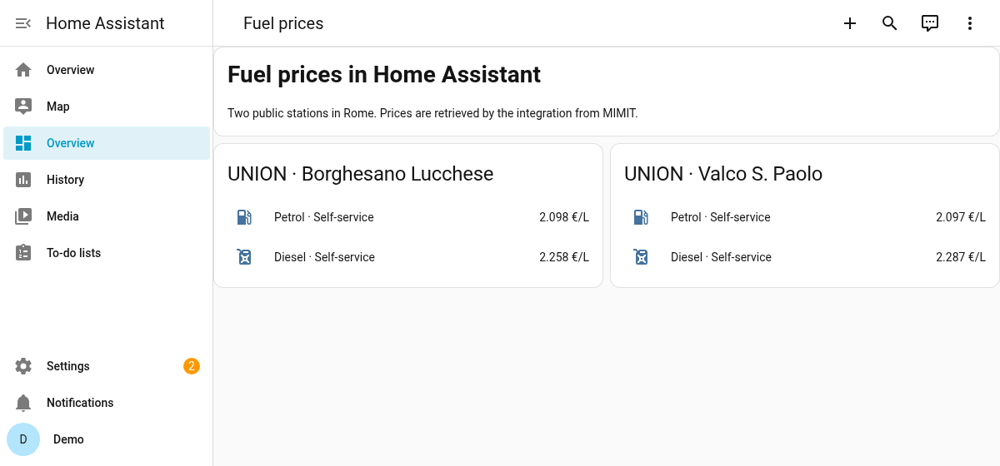
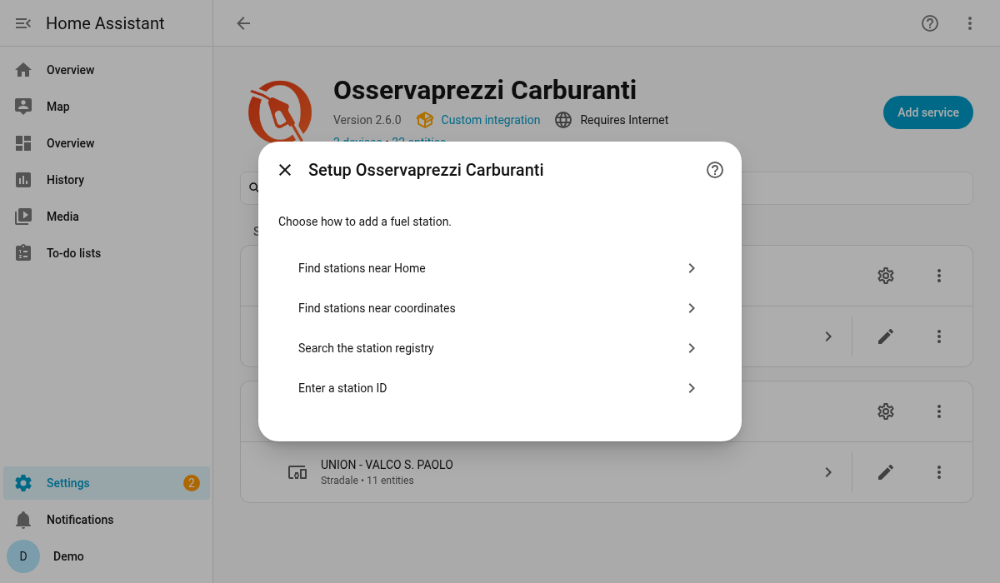
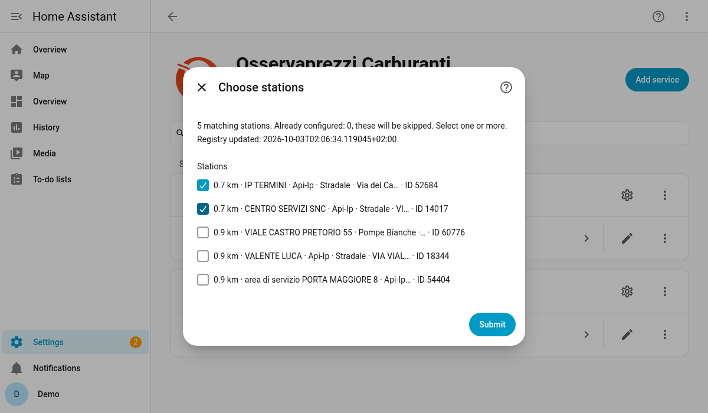

# Osservaprezzi Carburanti for Home Assistant

[🇮🇹 Leggi in Italiano](./README.it.md)

Home Assistant custom integration that tracks Italian fuel station prices, schedules, and services from the official [MIMIT Osservaprezzi](https://carburanti.mise.gov.it/) data sources.

## Preview

Fuel prices from two public stations rendered with Home Assistant's built-in dashboard cards:



<details>
<summary>Station discovery and multi-station setup</summary>

Choose from Home location, manual coordinates, a Home Assistant zone, municipality/registry search, or a station ID:



Select one or more stations from the search results in a single setup flow:



</details>

<sub>Captured on 3 October 2026 in an isolated demo profile using central Rome for discovery. Station metadata and prices come from MIMIT and are illustrative snapshots, not live quotes.</sub>

---

## Features

- **Fuel price sensors** — automatic `€/L` sensors (3-decimal precision) for each available fuel and service mode (Self / Servito), with price delta, direction (`up`/`down`/`unchanged`/`new`), staleness tracking, and rolling 30-day stats (`min_30d`, `max_30d`, `avg_30d`, `vs_avg_30d_pct`, `is_30d_low`).
- **5 station setup & discovery methods** — search locally over the cached official MIMIT registry near Home, manual coordinates, a Home Assistant zone, or by municipality/province, or enter a station ID directly. Supports multi-station selection and in-place **Reconfigure**.
- **Privacy-first local search** — coordinates and zones are used only in memory inside Home Assistant to compute distances; they are never persisted by the integration or sent to MIMIT.
- **Flexible refresh & filtering** — preset schedules or custom 5-field cron expressions (Home Assistant time zone), configurable staleness threshold (6–168 h), optional fuel and service-mode filters, plus a per-station **Refresh prices** button.
- **Schedules, services & metadata** — open/closed binary sensor, next opening/closing change sensor (with Italian national holidays), station info & GPS location sensors, and diagnostic binary sensors for 11 station services.
- **Actions, events & blueprints** — ranked price comparison (with cost/savings for a refuel volume and distance sorting), targeted refresh, local registry search, `osservaprezzi_carburanti_price_changed` event, and ready-to-use automation blueprints.
- **Resilience & Repairs** — persists the last known payload across restarts and temporary upstream outages, exposes fixable Repairs issues when a station disappears (404), and warns if the shared CSV registry becomes stale.

---

## Installation

### Marketplace (Home Assistant 2026.11 and newer)

1. Open **Settings → Marketplace** and accept the notice if prompted.
2. Search for **Osservaprezzi Carburanti** and select **Install**.
3. Restart Home Assistant if prompted.

Marketplace replaces HACS starting in Home Assistant 2026.11; existing HACS installs migrate automatically. See the [Marketplace documentation](https://www.home-assistant.io/integrations/marketplace/).

### HACS (Home Assistant 2026.10 and older)

1. Install [HACS](https://hacs.xyz/docs/installation/installation/) if needed.
2. Search for **Osservaprezzi Carburanti** in HACS and download it.
3. Restart Home Assistant.

<details>
<summary>Testing pre-releases</summary>

Available pre-releases are listed on the [Releases page](https://github.com/casungo/osservaprezzi-carburanti-ha/releases).

1. Go to **Settings → Devices & services → Marketplace** (HA 2026.11+) or **HACS** (older versions).
2. Open the **Osservaprezzi Carburanti** repository device page.
3. Show disabled entities, enable the **Pre-release** switch, and turn it on.
4. Install the pre-release from the repository page or update entity.

Turn the switch off to return to stable releases for future updates. To revert an installed pre-release, restore a backup created before updating.

</details>

---

## Configuration

Go to **Settings → Devices & services → + Add integration**, search for **Osservaprezzi Carburanti**, or click:

[](https://my.home-assistant.io/redirect/config_flow_start/?domain=osservaprezzi_carburanti)

### Setup methods

- **Find stations near Home** — uses Home Assistant's Home location with a custom radius (0.1–200 km).
- **Find stations near coordinates** — enter latitude/longitude manually (used only in memory).
- **Find stations near a zone** — pick any Home Assistant `zone.*` entity.
- **Search the station registry** — filter by municipality, province, free text, and station type (case- and accent-insensitive, 1–100 results).
- **Enter a station ID** — direct entry using the ID from `https://carburanti.mise.gov.it/ospzSearch/dettaglio/<ID>`.

Use **Reconfigure** on an existing station entry at any time to switch to another station without recreating the entry.

### Options

Each configured station supports:

- **Refresh schedule** — presets: daily at 08:30 (default, `30 8 * * *`), twice daily at 07:30 & 19:30 (`30 7,19 * * *`), every 6 hours (`0 */6 * * *`), weekdays at 08:00 (`0 8 * * 1-5`), or **Custom** 5-field cron (see [Crontab Guru](https://crontab.guru/)). Displays the next scheduled run time in Home Assistant's time zone.
- **Price staleness threshold** — mark prices stale after `6`, `12`, `24` (default), `48`, `72`, or `168` hours.
- **Tracked fuels & service modes** — optionally limit created price sensors to selected fuel types and/or Self vs. Servito modes (leave empty to track all).

---

## Entities

| Platform | Entities | Notes |
| --- | --- | --- |
| **Sensor** | Fuel prices (one per fuel & Self/Servito mode) | State in `€/L` (3 decimals). Attributes: `fuel_type_name`, `is_self_service`, `last_update`, `validity_date`, `previous_price`, `price_changed_at`, `price_delta`, `price_direction`, `price_age_minutes`, `price_is_stale`, `min_30d`, `max_30d`, `avg_30d`, `vs_avg_30d_pct`, `is_30d_low`, plus station metadata. |
| **Sensor** | Station info (`Name`, `Station Name`, `Osservaprezzi ID`, `Brand`, `Company`, `Phone`, `Email`, `Website`, `Location`) | Diagnostic metadata; `Location` exposes GPS coordinates for map cards. |
| **Sensor** | `Next Schedule Change` | Next opening/closing time (`opens_at`, `closes_at`, `always_open`, `no_schedule`, `no_opening`), accounting for Italian holidays. |
| **Binary sensor** | `Open` | Current open/closed status with `today_schedule`, `self_service_available`, and `served_available` attributes. |
| **Binary sensor** | Station services (disabled by default, diagnostic) | Food & Beverage, Workshop, Camper/Truck Parking, Camper Dump Station, Children's Area, ATM, Disabled Services, Wi-Fi, Tire Service, Car Wash, EV Charging. |
| **Button** | `Refresh prices` | Manually refreshes that station only; also usable to retry after transient errors. |

---

## Actions (Services)

All actions are registered globally under `osservaprezzi_carburanti`. Shared CSV operations execute once and synchronize all loaded stations.

| Action | Response | Description |
| --- | --- | --- |
| `compare_stations` | Required (`stations`, `ranking`) | Compares loaded stations and returns a sorted ranking. Supports `fuel_type`, `service_mode` (`any`/`self`/`served`), `exclude_stale`, `only_open`, `liters` (computes `estimated_total_eur` and `savings_eur`), `sort_by` (`price`/`distance`), and origin (`latitude`/`longitude` or `zone`). |
| `refresh_prices` | Optional (`refreshed_station_ids`, `refreshed_count`) | Refreshes all active stations, or only those targeted by `device_id`, `entity_id`, or `station_ids`. Fails explicitly if a refresh cannot fetch fresh data. |
| `search_registry` | Required (`results`, `result_count`, `registry_updated`, `registry_is_stale`) | Searches the local cached registry by area (`municipality`, `province`, `query`, `station_type`) or proximity (`latitude`/`longitude` or `zone`, `radius_km`), up to `limit` (1–50), flagging already configured stations. |
| `force_csv_update` | None | Downloads the official MIMIT station registry CSV immediately and refreshes all loaded stations. |
| `clear_cache` | None | Clears the shared CSV cache, downloads a fresh copy, and refreshes all loaded stations. |

<details>
<summary>Action YAML examples</summary>

```yaml
# Compare self-service diesel prices across open stations for a 50L refuel
action: osservaprezzi_carburanti.compare_stations
data:
  fuel_type: gasolio
  service_mode: self
  only_open: true
  exclude_stale: true
  liters: 50
  sort_by: price
response_variable: station_comparison
```

```yaml
# Refresh specific stations by ID (or use device_id / entity_id)
action: osservaprezzi_carburanti.refresh_prices
data:
  station_ids:
    - "54233"
response_variable: refresh_result
```

```yaml
# Search the local registry near a zone or by municipality
action: osservaprezzi_carburanti.search_registry
data:
  municipality: Roma
  query: Eni
  limit: 10
response_variable: registry_results
```

</details>

---

## Events & Automation Blueprints

### Price-changed event

Whenever a fuel price changes during a refresh, the integration fires `osservaprezzi_carburanti_price_changed` with:

`station_id`, `station_name`, `fuel`, `fuel_key`, `is_self`, `old_price`, `new_price`, `delta`, and `direction` (`up` / `down`).

### Blueprints

Ready-to-use automation blueprints are provided in [`blueprints/automation/osservaprezzi_carburanti/`](./blueprints/automation/osservaprezzi_carburanti/):

- **`fuel_price_drop_alert.yaml`** — notifies when a price drops below a target or by a minimum delta using `osservaprezzi_carburanti_price_changed`.
- **`cheapest_station_digest.yaml`** — sends a scheduled ranking digest using `osservaprezzi_carburanti.compare_stations`.

Copy the files into `<config>/blueprints/automation/osservaprezzi_carburanti/` in Home Assistant, create automations from them, and use `{{ message }}` in your notification action.

---

## Dashboard Examples

<details>
<summary>Built-in Lovelace cards (Map, Markdown ranking, Entities)</summary>

Replace the example entity IDs with your own (enable the `Location` sensor in the entity registry to use it on a map):

```yaml
type: map
entities:
  - entity: sensor.station_location
```

```yaml
type: markdown
content: >-
  | Station | Diesel (€/L) |
  |:--|--:|
  
  
  
  
  
  | {{ station }} | {{ price }} |
  
```

```yaml
type: entities
entities:
  - entity: sensor.station_one_diesel
  - type: attribute
    entity: sensor.station_one_diesel
    attribute: price_direction
    name: Price direction
  - type: attribute
    entity: sensor.station_one_diesel
    attribute: price_is_stale
    name: Price is stale
```

</details>

<details>
<summary>Custom Battery State Card (sorted price list)</summary>

Using [Battery State Card](https://github.com/maxwroc/battery-state-card):

```yaml
grid_options:
  columns: full
  rows: auto
type: custom:battery-state-card
title: Diesel
secondary_info: "{attributes.station_brand} - {attributes.station_address}"
icon: mdi:fuel
filter:
  include:
    - and:
        - or:
            - name: attributes.fuel_type_name
              value: Gasolio
            - name: attributes.fuel_type_name
              value: Blue*
        - name: entity.platform
          value: osservaprezzi_carburanti
  exclude:
    - name: attributes.validity_date
      operator: ">"
      value: 24h
sort:
  - by: state
    desc: false
collapse: 6
colors:
  steps:
    - value: 1.6
      color: "#00ff00"
    - value: 2
      color: "#ffff00"
    - value: 2.4
      color: "#ff0000"
  gradient: true
tap_action:
  action: navigate
  navigation_path: /config/devices/device/{entity.device_id}
```

To display all fuel types grouped by name, replace `filter` with a wildcard (`value: "*"`) and add `group: [{ by: attributes.fuel_type_name }]`.

</details>

---

## Diagnostics & Troubleshooting

- **Privacy-safe diagnostics**: Home Assistant's diagnostics download includes options, coordinator status/counts, and shared registry health; station IDs, names, addresses, and coordinates are redacted or omitted.
- **Prices look stale**: verify the cron expression and staleness threshold in the integration options, then run `osservaprezzi_carburanti.refresh_prices` (or press the device's **Refresh prices** button).
- **Registry search finds nothing**: the local registry copy may be outdated — run `osservaprezzi_carburanti.force_csv_update` (or `clear_cache`) and try again.
- **Station not found (404)**: open **Settings → System → Repairs** to replace the station ID or remove the entry.

---

## Development & Support

- **Docs**: [Testing & local checks](./docs/testing.md) · [Release validation](./docs/release-validation.md) · [MIMIT API notes](./docs/api-notes.md)
- **Issues & requests**: open a [GitHub issue](https://github.com/casungo/osservaprezzi-carburanti-ha/issues/new) including the integration version, setup method, and the Home Assistant diagnostics download.

## License

Released under the [MIT License](./LICENSE).
